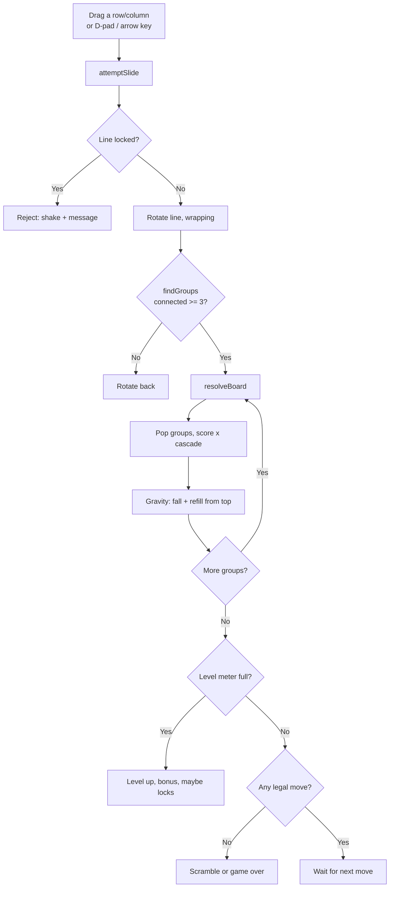

# 🫧 Fuzzle

<!-- Hero screenshot, to be captured from the real game (see docs/REVIEW.md,
     Visual asset strategy). Uncomment once the file exists; do not ship a
     placeholder or a staged image.

-->

## Description

Fuzzle is a Chuzzle-inspired sliding match game that runs entirely as static
files — no build step, no backend, no dependencies, no tracking.

Slide a whole row or column. It wraps around: a fuzzy pushed off the left
reappears on the right, off the top at the bottom. Form a connected group of
3 or more fuzzies of the same colour — lines, L-shapes, and 2×2 blocks all
count — and they pop. The ones above fall down, new fuzzies drop in from
the top, and cascades multiply your score. Fill the level meter to level up.
From level 2, locked fuzzies freeze their row and column until you pop them.

> Fan-made tribute. Inspired by the *mechanics* of Chuzzle (Raptisoft /
> PopCap). Not affiliated with PopCap or EA. All art, sounds (WebAudio
> blips), and code in this repo are original — no PopCap assets are used.

## Prerequisites

- A modern browser (Chrome, Firefox, Safari, or Edge, current or
  previous major version). No plugins, no account, no server.
- For local development only: Python 3 (for `http.server`) **or** any
  static server, and Node.js 20+ for the tests (developed and tested on
  Node v24.22.1). There is nothing to install with npm — the repo has no
  `package.json` and no dependencies.
- For deployment only: a GitHub account and, optionally, the GitHub CLI
  (`gh`) for setting the description/topics after pushing.

## Installation

There is no install step and no build step. Clone the repo and you have
the whole game:

```sh
git clone https://github.com/enonymous1/fuzzle.git
cd fuzzle
```

That is it. `index.html` + `style.css` + `game.js` is the game;
`tests/` is the test suite and `.github/workflows/pages.yml` is the
deployment workflow. Nothing else is required to run it.

## Local Development

Serve the repo root with any static server. Do not just open
`index.html` from a file manager if you want the exact Pages behaviour —
a server is one command and avoids any file-URL quirks:

```sh
# from the repo root:
python3 -m http.server 8000
# then open http://localhost:8000/
```

Useful commands:

```sh
node --check game.js
# Run the test suite (explicit file list: `node --test tests/` mis-resolves
# the directory as a module on Node v24):
node --test tests/logic.test.js tests/board-smoke.test.js
```

### How to play

- **Drag** any fuzzy horizontally to slide its whole row, or vertically to
  slide its whole column. Rows and columns **wrap around**.
- Form a connected group of **3 or more** of the same colour. They pop,
  gravity refills from the top, and cascades score extra.
- A move that makes no match **slides back**.
- Fill the level meter to level up (+1000 × level bonus). From level 2,
  🔒 locked fuzzies appear: they freeze their row and column until you
  pop them, and popping one is worth +50.
- If no move exists, use a **Scramble** (you start with 3). No moves and
  no scrambles = game over.
- **Hint** shows a legal move. Tap a fuzzy to select it, then use the
  on-screen arrows or your keyboard arrow keys for precise one-step
  slides. Best score is saved in your browser only (`localStorage`).

### Scoring

| Event | Points |
| --- | --- |
| Each popped fuzzy | 10 |
| Each fuzzy beyond 3 in a group | +20 (so 4 = 60 base, 5 = 90 base, before cascade) |
| Cascade | Whole group score × cascade number (x2, x3, …) |
| Popping a locked fuzzy | +50 |
| Level-up bonus | 1000 × new level |

The level meter counts *pops*, not points, so a big cascade cannot skip a
level. Level targets start at 40 pops and grow by 15 per level.

### Architecture

One page, one stylesheet, one script — deliberately. See
[`docs/REVIEW.md`](docs/REVIEW.md) for the full staff review, including
why the file is not yet split into ES modules (it would break `file://`
use) and what would trigger that split.



File map:

| File | What it is |
| --- | --- |
| `index.html` | Page, HUD, board container, how-to |
| `style.css` | Board, fuzzy blobs (pure CSS), HUD, reduced-motion support |
| `game.js` | `CONFIG`, pure board logic (matcher, rotation), UI, input, sound, scoring |
| `tests/logic.test.js` | Pure-logic tests: wrap, rotation, line/L/2×2 matches, diagonal and pair non-matches |
| `tests/board-smoke.test.js` | Loads the real `game.js` against a DOM stub, asserts 36 valid tiles |
| `.github/workflows/pages.yml` | Checks, tests, then deploys the repo root to GitHub Pages on push to `main` |
| `docs/REVIEW.md` | Staff review: findings, fixes, deferred items, visual asset strategy |

All links in the page are relative, so the game works under a project
Pages subpath (`/fuzzle/`) as well as at a site root.

### Accessibility

- Tiles carry `aria-label`s naming their colour and locked state; colour
  is not the only *announced* signal, but it is still the only *visual*
  distinction — per-colour patterns for colourblind players are a
  documented follow-up in `docs/REVIEW.md`, not a claim already made.
- Buttons have visible focus styles, and `prefers-reduced-motion`
  disables wobble, shake, and transitions.
- Sound is WebAudio blips only, with a toggle; a failed blip never
  breaks a move.

## Deployment

Deployment is GitHub Pages via the workflow in
`.github/workflows/pages.yml`. On every push to `main` (or a manual
dispatch) it checks the files, runs the tests, then deploys the repo root
with `configure-pages@v5` + `upload-pages-artifact@v3` +
`deploy-pages@v4`.

> Version note, learned the hard way on another repo:
> `upload-pages-artifact@v3` **must** be deployed with `deploy-pages@v4`
> or newer — v2 cannot find the v3 artifact ("Cannot find any run"), and
> re-running an old run reuses that run's workflow file, so a fresh push
> or dispatch is required after a workflow fix.

One-time setup, after the first push:

1. Repo Settings → Pages → Source: **GitHub Actions**.
2. The site will be at `https://enonymous1.github.io/fuzzle/`.

To update the repo description and topics after pushing, see the `gh
repo edit` command in the maintainer's notes (description/topics are
applied by the maintainer, not by the workflow).

## Visual assets

No screenshots or GIFs are shipped yet, and none have been fabricated.
The exact shot list — hero board, wrap-drag, cascade-pop, mobile, and a
demo GIF, with the files they must live in and where each goes in this
README — is in [`docs/REVIEW.md`](docs/REVIEW.md), § Visual asset
strategy. When a capture exists, drop it into
`docs/assets/screenshots/` under the name already referenced in the
placeholder above; no README edit is needed at capture time.

## Roadmap

- [x] 6×6 wrap-sliding board, connected-group matches, gravity, cascades
- [x] Score, level meter + bonus, best score, locks, scrambles, hints, sounds, touch + keyboard
- [x] Staff review fixes (v1.1): `CONFIG`, JSDoc, testable pure logic, Node tests, drag performance, selection-by-id
- [ ] Fat fuzzies (2×2) and Super fuzzies (5+ match explodes 3×3) from the original — not in v1
- [ ] Mind Bender puzzle mode (match a target pattern) — not in v1
- [ ] Speed / Zen modes — not in v1
- [ ] Colourblind patterns per colour, full keyboard board navigation — see `docs/REVIEW.md` P2

## License

MIT — see `LICENSE`.
